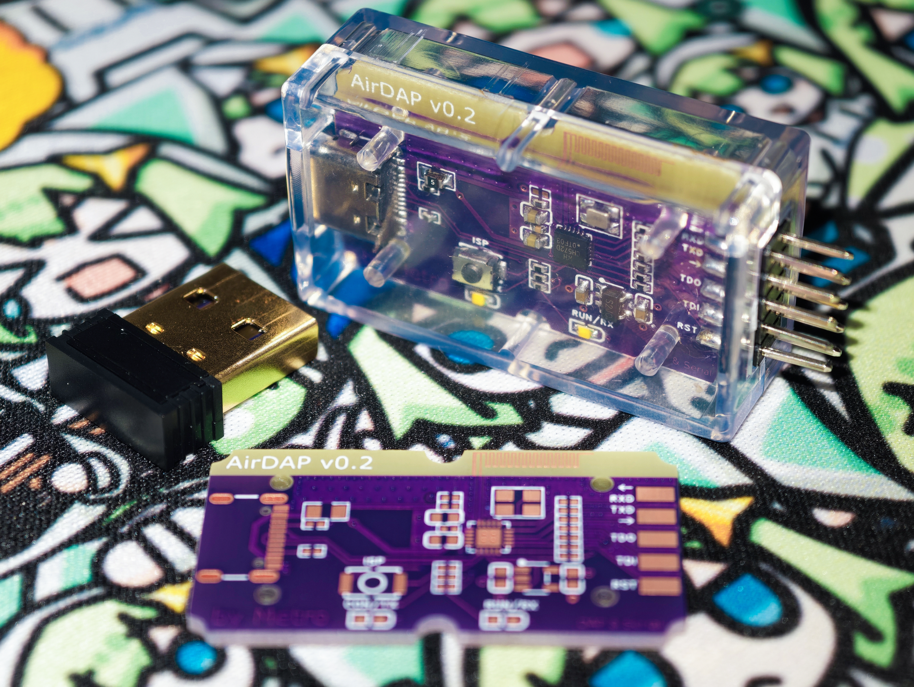

[简体中文](README_zh.md)

# AirDAP: A low-cost, high-performance 2.4 GHz wired & wireless DAP debugger and serial port implementation based on WCH CH570/CH572

## Introduction

AirDAP is a wireless serial adapter and DAP debug probe based on WCH CH570/CH572 microcontrollers. It supports wireless connections over a proprietary 2.4 GHz protocol, as well as standalone wired USB connections. CH570D/CH572D is recommended for full functionality; CH572R does not support JTAG debugging.

AirDAP is a minimal debug probe design. A pair of AirDAP boards costs just CNY 5 while delivering good performance in both wired and wireless modes. It can also be paired with a dedicated USB dongle, TinyDongle, which uses CH570/CH572 as well (CH570Q is recommended), to further reduce cost and size.

The software is licensed under the MIT License, and the hardware under CERN-OHL-P-2.0.

## Features

AirDAP supports both wired and wireless operation:

* In wired mode, it works like a conventional USB-to-serial adapter and CMSIS-DAP debug probe, using the operating system's built-in drivers.
* In wireless mode, it automatically pairs new devices and switches channels. With a good signal, its performance is comparable to low- to medium-speed wired connections.

Both wired and wireless modes support serial baud rates of 1 Mbaud and 1.5 Mbaud, and CMSIS-DAP supports up to 25 MHz (SWD and JTAG). Wireless throughput is lower than wired throughput due to the limitations of the 2.4 GHz link; see the measurements below.

In addition to wireless serial communication and DAP debugging, AirDAP provides:

* An optional 3.3 V LDO dedicated to powering external devices. The LDO can be enabled or disabled through wired or wireless control, for use cases such as entering debug mode as a target powers up.
* An optional ISP button. Holding it during power-up enters ISP mode, primarily for debugging AirDAP itself. AirDAP also supports USB DFU, so manual ISP entry is not required for every firmware update.

## How It Works

The WCH CH570D/CH572D microcontrollers feature a RISC-V core, USB Full-Speed and a 2.4 GHz radio. Their system clock can run at up to 100 MHz, meeting the needs of serial communication and debugging.

* As a USB-to-serial adapter, AirDAP supports 1 Mbaud and 1.5 Mbaud, with full-rate transmit and receive in wired mode.
* For SWD debugging, SPI acceleration supports clock frequencies up to 25 MHz. JTAG is also supported.

AirDAP exposes a 2 × 5, 2.54 mm header footprint. Each signal has a series-resistor footprint for signal-integrity tuning.

AirDAP supports optional LDO control. The header's 3.3 V output can be controlled through the LDO_EN pin or connected directly to the CH570D/CH572D's built-in LDO, subject to its current limit.

AirDAP automatically selects its operating mode based on its environment. The mode can also be selected manually over USB; manual selection is lost when power is removed. The selection logic is:

* If no USB connection is detected within 2 seconds of power-up, AirDAP enters RF Target mode and can be connected to the device being debugged.
* If an advertisement from an AirDAP already in RF Target mode is detected within 2 seconds of power-up, it enters RF Host mode.
* If USB is connected within 2 seconds of power-up but no advertisement is detected, it enters Local mode and works as a wired debug probe.
* With TinyDongle firmware, it enters RF Host mode directly.

The LEDs indicate AirDAP's current state:

* In RF Host mode, both LEDs blink together once every 2 seconds while connected to another AirDAP; otherwise, they remain off by default.
* In RF Target mode, the LEDs alternate on a 1-second cycle while not connected to another AirDAP; otherwise, they remain off by default.
* During DAP activity, the LEDs in Local and RF Target modes indicate the connect and running states.
* During serial activity, the LEDs in Local and RF Target modes indicate active TX and RX.

## Flashing Firmware

For first-time use, enter ISP download mode by holding the ISP button while connecting USB; factory-fresh chips enter ISP mode automatically. Use `wchisp` or a similar tool to flash a `.hex` or `.bin` file. Once the initial firmware has been flashed successfully, subsequent updates can be performed over DFU.

## Performance Tests

The following measurements use AirDAP v1.0 firmware. All speeds are effective data throughput in kB/s (1 kB/s = 1000 B/s). DAP tests use an STM32F103C8T6 target, with bus clock frequencies of 25 MHz for SWD and 6.25 MHz for JTAG.

* “RX loss rate” is the proportion of data lost during receive-only operation because UART receive processing could not keep up.
* “TX / RX speed” lists the transmit and receive speeds during simultaneous transmission and reception.
* “Loss rate during TX/RX” is the proportion of data lost because UART receive processing could not keep up during simultaneous transmission and reception; transmission is lossless.

### Wired Serial

| Baud rate | TX speed | RX speed | RX loss rate | TX / RX speed | Loss rate during TX/RX |
| --- | --- | --- | --- | --- | --- |
| 115200 | 11.47 | 11.47 | 0% | 11.47 / 11.47 | 0% |
| 230400 | 23.15 | 23.15 | 0% | 23.15 / 23.15 | 0% |
| 460800 | 46.30 | 46.30 | 0% | 46.30 / 46.30 | 0% |
| 921600 | 93.75 | 93.75 | 0% | 93.75 / 93.75 | 0% |
| 125000 | 12.50 | 12.50 | 0% | 12.50 / 12.50 | 0% |
| 250000 | 25.00 | 25.00 | 0% | 25.00 / 25.00 | 0% |
| 500000 | 50.00 | 50.00 | 0% | 50.00 / 50.00 | 0% |
| 750000 | 75.00 | 74.99 | 0% | 75.00 / 75.01 | 0% |
| 1000000 | 100.00 | 100.00 | 0% | 100.00 / 100.00 | 0% |
| 1500000 | 150.00 | 150.00 | 0% | 150.00 / 150.02 | 0% |

### Wireless Serial

| Baud rate | TX speed | RX speed | RX loss rate | TX / RX speed | Loss rate during TX/RX |
| --- | --- | --- | --- | --- | --- |
| 115200 | 11.47 | 11.47 | 0% | 11.47 / 11.47 | 0% |
| 230400 | 23.15 | 23.15 | 0% | 23.02 / 23.04 | 0% |
| 460800 | 46.30 | 46.28 | 0% | 36.87 / 34.15 | 7.1394% |
| 921600 | 92.10 | 89.94 | 5.0295% | 50.39 / 46.28 | 6.7357% |
| 125000 | 12.50 | 12.50 | 0% | 12.50 / 12.50 | 0% |
| 250000 | 25.00 | 25.01 | 0% | 24.52 / 24.55 | 0.0854% |
| 500000 | 49.90 | 50.05 | 0% | 39.19 / 35.27 | 8.2486% |
| 750000 | 74.38 | 73.80 | 1.3967% | 48.27 / 46.80 | 2.3578% |
| 1000000 | 96.59 | 80.15 | 18.8294% | 49.79 / 45.78 | 6.6796% |
| 1500000 | 109.45 | 94.27 | 36.2340% | 53.43 / 48.83 | 8.4864% |

### Wired DAP

| Host software | DAP protocol (HID or Bulk) | SWD SRAM read speed | SWD SRAM write speed | JTAG SRAM read speed | JTAG SRAM write speed |
| --- | --- | --- | --- | --- | --- |
| OpenOCD dev | HID | 28.81 | 27.19 | 2.62 | 2.56 |
| pyOCD | HID | 28.38 | 26.87 | 28.38 | 26.74 |
| probe-rs | HID | 24.73 | 24.73 | 4.27 | 4.26 |
| OpenOCD dev | Bulk | 434.07 | 438.17 | 10.85 | 10.61 |
| pyOCD | Bulk | 417.20 | 407.49 | 195.06 | 220.15 |
| probe-rs | Bulk | 280.85 | 280.12 | 20.28 | 20.30 |

### Wireless DAP

| Host software | DAP protocol (HID or Bulk) | SWD SRAM read speed | SWD SRAM write speed | JTAG SRAM read speed | JTAG SRAM write speed |
| --- | --- | --- | --- | --- | --- |
| OpenOCD dev | HID | 26.20 | 25.00 | 1.19 | 1.19 |
| pyOCD | HID | 25.59 | 24.90 | 25.65 | 24.76 |
| probe-rs | HID | 21.35 | 21.63 | 2.21 | 2.21 |
| OpenOCD dev | Bulk | 51.68 | 52.96 | 1.85 | 1.85 |
| pyOCD | Bulk | 74.61 | 76.54 | 60.51 | 61.37 |
| probe-rs | Bulk | 50.55 | 53.19 | 3.23 | 3.24 |
