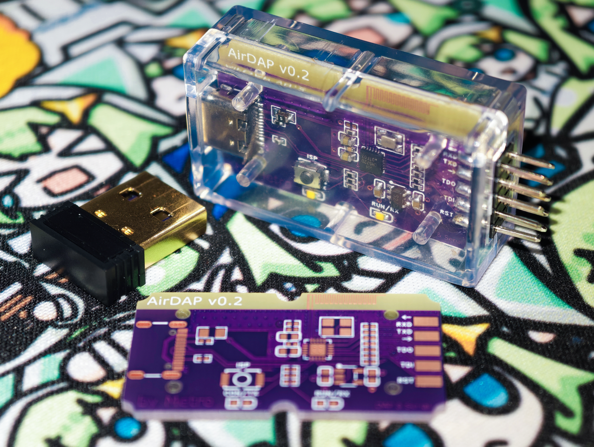

# AirDAP，超低成本2.4GHz无线串口+DAP调试器

## 简介



本项目是基于沁恒CH570/CH572单片机的无线串口+DAP调试器，支持通过2.4 GHz私有协议无线连接，也可以单独用USB有线连接。推荐使用CH570D/CH572D以使用完整功能，CH572R不支持JTAG调试。

本项目是调试器的最小实现，一对AirDAP成本仅为5元，但有线、无线性能均不俗，还能搭配专门的USB Dongle使用（TinyDongle，同样使用CH570/CH572，推荐CH570Q），进一步降低成本和体积。

本项目软件部分基于MIT许可协议，硬件部分基于CERN-OHL-P-2.0许可协议。

## 功能

本项目支持有线和无线两种工作模式，其中：

* 有线使用时，和普通的USB转串口、CMSIS-DAP调试器无异，可以免驱使用。
* 无线使用时，自动完成新设备的配对和信道切换，信号较好时可媲美中低速率有线连接。
在有线模式和无线模式下，串口波特率均支持到1 Mbaud和1.5 Mbaud，CMSIS-DAP支持到25 MHz（SWD和JTAG），其中无线模式受2.4 GHz传输性能影响速率低于有线模式，具体可参考后面的实测数据。

除了标准的无线串口和DAP调试器之外，AirDAP还支持以下功能：

* 可选的3.3V LDO，专用于对外供电，并且可通过有线或无线控制LDO使能，满足设备上电时进入调试等功能。
* 可选的ISP按钮，上电时按下可进入ISP模式，主要用于调试本体；AirDAP支持USB DFU，因此不需要在每次升级时都手动进入ISP模式。

## 原理解析

沁恒CH570D/CH572D是一款支持USB Full-Speed和2.4 GHz无线收发的RISC-V单片机，系统时钟频率可达100 MHz，可以满足串口和调试器的需求。

* 在作为USB转串口时，支持1 Mbaud和1.5 Mbaud波特率（有线模式可跑满收发）。
* 调试器在使用SWD协议时可利用SPI进行加速，最高支持25 MHz的时钟频率；也支持JTAG协议。
AirDAP引出了2x5p 2.54mm排针焊盘，所有信号都预留了串接电阻的位置，可用于调整信号质量。

AirDAP支持可选的LDO控制功能，排针的3.3V输出可以通过LDO_EN引脚控制，也可以直接和CH570D/CH572D内置的LDO直连（注意电流限制）。

AirDAP可根据使用环境自动识别工作模式，也可以通过USB手动选择工作模式（断电后失效）。目前使用逻辑如下：

* 若AirDAP上电后2s内无USB连接，则进入RF Target模式，可连接待调试设备。
* 若AirDAP上电后2s内检测到已进入RF Target模式的AirDAP广播信号，则进入RF Host模式。
* 若AirDAP上电后2s内有USB连接但未检测到广播信号，则进入Local模式，可以作为有线调试器使用。
* 如果使用TinyDongle的固件，则直接进入RF Host模式。

AirDAP的LED可以表示当前工作状态。其中：

* 在RF Host模式中，若正连接到另一个AirDAP，则每2s同时闪烁一次，否则默认熄灭。
* 在RF Target模式中，若暂未连接到另一个AirDAP，则每1s交替闪烁一次，否则默认熄灭。
* 在有DAP数据传输时，Local模式和RF Target模式使用LED表示connect和running状态。
* 在有串口数据传输时，Local模式和RF Target模式使用LED表示TX和RX正有数据传输。

## 目标绑定

Host（插电脑的一端）首次配对成功后会记住 Target 的 8 字节 UID，保存在 Host Flash 的
`0x1E000`/`0x1F000` 两个扇区中，掉电不丢。之后的启动行为：

* 已绑定：只连接该 UID；目标不在线时保持 Host 无限等待，不会降级到 Local，也不会连接其他
  Target；即使不插 USB 也保持 Host。
* 未绑定：保持原有行为，2 秒窗口内连接第一个听到的 Target，配对成功后自动保存。
* Host 已绑定但目标未上线时，LED1 每 1 秒闪一次；未绑定时两灯熄灭。

上位机可以通过 USB 厂商请求查询状态、指定绑定、忘记绑定或进入只扫描模式，协议见
`doc/01_bind_guide/binding_zh.md`。脚本示例：

```bash
python3 tool/01_airdap_bind/airdap_bind.py list
python3 tool/01_airdap_bind/airdap_bind.py --serial <16位UID> show
python3 tool/01_airdap_bind/airdap_bind.py --serial <16位UID> bind 0011223344556677
python3 tool/01_airdap_bind/airdap_bind.py --serial <16位UID> forget
python3 tool/01_airdap_bind/airdap_bind.py --serial <16位UID> peers
python3 tool/01_airdap_bind/airdap_bind.py --serial <16位UID> exit-wireless
```

注意事项：

* 首次配对应先给 Target 上电，再给 Host 上电或插 USB；否则 2 秒窗口结束后 Host 会退到 Local。
* `forget` 后进入 scan-only，可以列出周围所有 Target；只有 `bind` 或重新上电才会退出。
* DFU 升级覆盖 `0x0~0x3C000`，可能清掉绑定记录，升级后需要重新配对或重新 bind。
* `exit-wireless` 只在本次运行中切到 Local，断电后仍按绑定恢复 Host。

## 烧录方法

初次使用时，请进入ISP下载模式（按住ISP按钮插入USB，在出厂时默认直接进入ISP），并使用`wchisp`等工具下载`.hex`或`.bin`文件。成功烧录后，后续即可通过DFU通道更新固件。

## 速度测试

以下数据基于AirDAP v1.0固件进行，单位为kB/s（1 kB/s = 1000 B/s），所有速度均为有效数据吞吐。DAP部分连接STM32F103C8T6，线速度分别为25 MHz（SWD）和6.25 MHz（JTAG）。

* “接收丢包率”指的是单向接收时因串口接收处理不及时造成丢包的比例
* “收发速度”指的是同时收发时的发送速度和接收速度
* “收发丢包率”指的是同时收发时因串口接收处理不及时造成丢包的比例（发送不丢包）

### 有线串口

| 波特率 | 发送速度 | 接收速度 | 接收丢包率 | 收发速度 | 收发丢包率 |
| --- | --- | --- | --- | --- | --- |
| 115200 | 11.47 | 11.47 | 0% | 11.47 / 11.47 | 0% |
| 230400 | 23.15 | 23.15 | 0% | 23.15 / 23.15 | 0% |
| 460800 | 46.30 | 46.30 | 0% | 46.30 / 46.30 | 0% |
| 921600 | 93.75 | 93.75 | 0% | 93.75 / 93.75 | 0% |
| 125000 | 12.50 | 12.50 | 0% | 12.50 / 12.50 | 0% |
| 250000 | 25.00 | 25.00 | 0% | 25.00 / 25.00 | 0% |
| 500000 | 50.00 | 50.00 | 0% | 50.00 / 50.00 | 0% |
| 750000 | 75.00 | 74.99 | 0% | 75.00 / 75.01 | 0% |
| 1000000 | 100.00 | 100.00 | 0% | 100.00 / 100.00 | 0% |
| 1500000 | 150.00 | 150.00 | 0% | 150.00 / 150.02 | 0% |

### 无线串口

| 波特率 | 发送速度 | 接收速度 | 接收丢包率 | 收发速度 | 收发丢包率 |
| --- | --- | --- | --- | --- | --- |
| 115200 | 11.47 | 11.47 | 0% | 11.47 / 11.47 | 0% |
| 230400 | 23.15 | 23.15 | 0% | 23.02 / 23.04 | 0% |
| 460800 | 46.30 | 46.28 | 0% | 36.87 / 34.15 | 7.1394% |
| 921600 | 92.10 | 89.94 | 5.0295% | 50.39 / 46.28 | 6.7357% |
| 125000 | 12.50 | 12.50 | 0% | 12.50 / 12.50 | 0% |
| 250000 | 25.00 | 25.01 | 0% | 24.52 / 24.55 | 0.0854% |
| 500000 | 49.90 | 50.05 | 0% | 39.19 / 35.27 | 8.2486% |
| 750000 | 74.38 | 73.80 | 1.3967% | 48.27 / 46.80 | 2.3578% |
| 1000000 | 96.59 | 80.15 | 18.8294% | 49.79 / 45.78 | 6.6796% |
| 1500000 | 109.45 | 94.27 | 36.2340% | 53.43 / 48.83 | 8.4864% |

### 有线DAP

| 上位机 | DAP协议 (HID or Bulk) | SWD SRAM读速度 | SWD SRAM写速度 | JTAG SRAM读速度 | JTAG SRAM写速度 |
| --- | --- | --- | --- | --- | --- |
| OpenOCD dev | HID | 28.81 | 27.19 | 2.62 | 2.56 |
| pyOCD | HID | 28.38 | 26.87 | 28.38 | 26.74 |
| probe-rs | HID | 24.73 | 24.73 | 4.27 | 4.26 |
| OpenOCD dev | Bulk | 434.07 | 438.17 | 10.85 | 10.61 |
| pyOCD | Bulk | 417.20 | 407.49 | 195.06 | 220.15 |
| probe-rs | Bulk | 280.85 | 280.12 | 20.28 | 20.30 |

### 无线DAP

| 上位机 | DAP协议 (HID or Bulk) | SWD SRAM读速度 | SWD SRAM写速度 | JTAG SRAM读速度 | JTAG SRAM写速度 |
| --- | --- | --- | --- | --- | --- |
| OpenOCD dev | HID | 26.20 | 25.00 | 1.19 | 1.19 |
| pyOCD | HID | 25.59 | 24.90 | 25.65 | 24.76 |
| probe-rs | HID | 21.35 | 21.63 | 2.21 | 2.21 |
| OpenOCD dev | Bulk | 51.68 | 52.96 | 1.85 | 1.85 |
| pyOCD | Bulk | 74.61 | 76.54 | 60.51 | 61.37 |
| probe-rs | Bulk | 50.55 | 53.19 | 3.23 | 3.24 |
